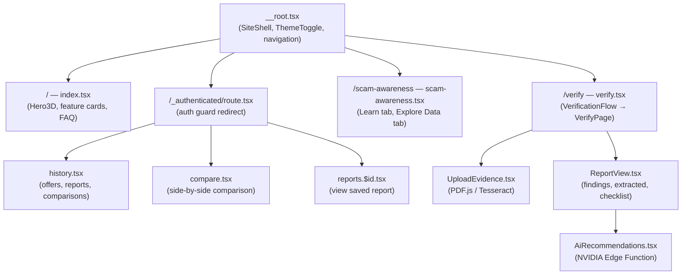
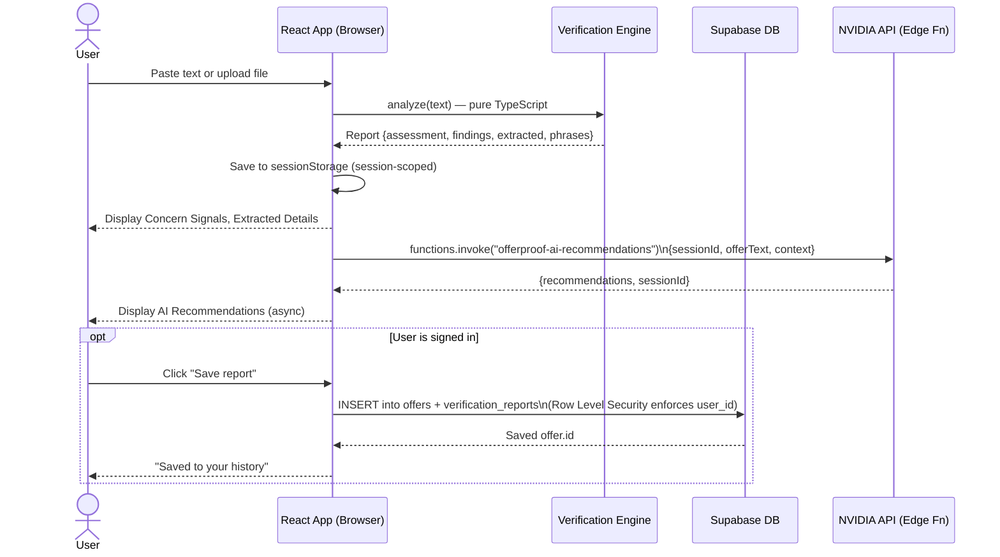

# System Architecture

## High-Level Architecture Diagram

```mermaid
flowchart TD
    subgraph Browser["User Browser"]
        UI["React + TanStack Router SPA"]
        ENGINE["Verification Engine\nsrc/lib/verify/engine.ts\n(pure TypeScript, no server)"]
        PDFJS["PDF.js Web Worker\n(text extraction)"]
        TESSERACT["Tesseract.js Web Worker\n(OCR)"]
        SESSION["sessionStorage\n(session isolation)"]
        LOCALSTORAGE["localStorage\n(guest pending queue)"]
    end

    subgraph Supabase["Supabase Cloud"]
        AUTH["Supabase Auth\n(magic link / OAuth)"]
        DB["PostgreSQL Database\noffers · verification_reports · comparisons"]
        FN_AI["Edge Function\nofferproof-ai-recommendations\n(Deno)"]
        FN_BQ["Edge Function\nofferproof-job-postings\n(Deno)"]
    end

    subgraph External["External Services"]
        NVIDIA["NVIDIA Inference API\nnvidia/nemotron-3.5-bolt-e4b"]
        BQ["Google BigQuery\nxenon-hub-514707-f9\nofferproof_analytics.job_postings"]
        GOOGLE_OAUTH["Google OAuth2\nToken Endpoint"]
    end

    UI -->|paste / file text| ENGINE
    UI -->|upload PDF| PDFJS
    UI -->|upload image| TESSERACT
    PDFJS -->|extracted text| UI
    TESSERACT -->|OCR text| UI
    ENGINE -->|Report object| UI
    UI <-->|read/write session state| SESSION
    UI <-->|guest pending offers| LOCALSTORAGE

    UI -->|supabase.auth.*| AUTH
    UI -->|supabase.from()| DB
    DB -->|Row Level Security| AUTH

    UI -->|supabase.functions.invoke()| FN_AI
    FN_AI -->|POST /chat/completions| NVIDIA
    NVIDIA -->|AI recommendations text| FN_AI
    FN_AI -->|structured response| UI

    UI -->|supabase.functions.invoke()| FN_BQ
    FN_BQ -->|service account JWT| GOOGLE_OAUTH
    GOOGLE_OAUTH -->|access token| FN_BQ
    FN_BQ -->|BigQuery REST API| BQ
    BQ -->|query results| FN_BQ
    FN_BQ -->|records + summary| UI
```

---

## Component Map



---

## Data Flow: Offer Verification



---

## Multi-User Session Isolation

Each browser window/tab gets a unique session ID generated with `crypto.randomUUID()` (or a timestamp fallback) stored in `sessionStorage`.

```
sessionStorage["offerproof:session:id"]     → "abc-uuid-..."
sessionStorage["offerproof:session:state:abc-uuid-..."] → { text, report, ... }
```

Because `sessionStorage` is strictly scoped to one browser tab, no two sessions can read or overwrite each other's state — including across different browsers (Firefox vs Chrome).

The session ID also travels in the `offerproof-ai-recommendations` request body so the Edge Function echoes it back; the client validates `data.sessionId === effectiveSessionId` before applying any response, preventing cross-session race conditions.

---

## Security Boundary Summary

| Layer | Mechanism |
|---|---|
| **Browser ↔ Supabase DB** | Publishable key + JWT Bearer token; Row Level Security on every table |
| **Browser ↔ Edge Functions** | Supabase `functions.invoke()` (auto-attaches user JWT) |
| **Edge Function ↔ NVIDIA** | `NVIDIA_API_KEY` Supabase secret — never exposed to client |
| **Edge Function ↔ BigQuery** | `GOOGLE_SERVICE_ACCOUNT_JSON` Supabase secret; short-lived OAuth2 access token minted at request time |
| **SSR server auth** | `requireSupabaseAuth` middleware validates JWT before any server function runs |
